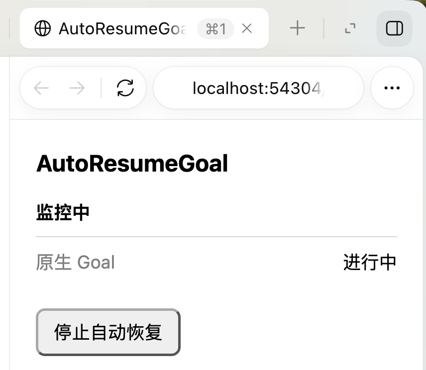

# AutoResumeGoal

[English](README.md) · [简体中文](README.zh-CN.md) · [繁體中文](README.zh-TW.md) · [日本語](README.ja.md) · [한국어](README.ko.md) · [Tiếng Việt](README.vi.md)

**Tự động tiếp tục Goal của Codex trong cùng cuộc trò chuyện khi hạn mức sử dụng được khôi phục.**


> Bản xem trước cho Linux. Dịch vụ theo dõi chạy trên Linux có systemd.

## Minh họa thực tế

Bảng bên hiển thị trạng thái Goal, thời điểm kiểm tra hạn mức tiếp theo và thời điểm gần nhất xác nhận lượt mới trong cuộc trò chuyện ban đầu.

| Đang theo dõi | Chờ khôi phục hạn mức | Đã xác nhận tiếp tục |
| :---: | :---: | :---: |
|  |  |  |

## Bắt đầu nhanh

Chạy các lệnh dưới đây trên máy Linux nơi Goal chạy. Kiểm tra bản cài đặt hiện có trước khi sao chép. Nếu không thấy `$auto-resume-goal` trong danh sách kỹ năng, hãy khởi động lại Codex.

```bash
git clone https://github.com/realpan/auto-resume-skill.git
cd auto-resume-skill
mkdir -p "$HOME/.agents/skills"
cp -R skills/auto-resume-goal "$HOME/.agents/skills/"
python3 -m pip install -r requirements.txt
```

Cần Python 3.9 trở lên, trình quản lý dịch vụ người dùng systemd đang chạy và Codex đã đăng nhập, bật Goal. Kết nối với App Server quản lý cuộc trò chuyện ban đầu. Nếu dùng môi trường ảo, hãy dùng Python trong môi trường đó để cài đặt phụ thuộc và chạy công cụ.

```text
$auto-resume-goal Chuyển sang bộ phân tích ngày mới. Hoàn tất khi bộ phân tích xử lý được toàn bộ dữ liệu kiểm thử và mọi bài kiểm thử đều đạt.
```

| Thao tác | Lệnh |
| --- | --- |
| Theo dõi Goal hiện tại | `$auto-resume-goal monitor this goal` |
| Kiểm tra trạng thái | `$auto-resume-goal status` |
| Dừng theo dõi | `$auto-resume-goal stop` |

### Dùng máy Linux từ xa trên macOS hoặc Windows

Kết nối Codex trên máy tính với máy Linux có systemd và mở dự án từ xa. Khởi động Goal trong cuộc trò chuyện từ xa rồi cài kỹ năng trên Linux bằng tài khoản chạy Codex. Bật theo dõi và kiểm tra trạng thái trong cùng cuộc trò chuyện. Bảng bên cần ứng dụng máy tính truy cập được dịch vụ loopback trên máy từ xa. Bạn cũng có thể dùng lệnh trạng thái và nhật ký dịch vụ.

## Cách hoạt động

Dịch vụ gắn với ID cuộc trò chuyện, thời điểm tạo Goal và dấu vân tay của mục tiêu. Mỗi cuộc trò chuyện chỉ có một trình theo dõi. Khi Goal chuyển sang `usageLimited`, thời điểm đặt lại của hạn mức đã hết quyết định lịch kiểm tra tiếp theo. Khi hạn mức thông thường được xác nhận là khả dụng, cuộc trò chuyện đang rảnh và Goal vẫn khớp, dịch vụ yêu cầu tiếp tục Goal với mục tiêu và ngân sách ban đầu. Nếu không xác nhận được lượt mới trong cuộc trò chuyện cũ, dịch vụ sẽ dừng.

Dịch vụ dừng khi Goal hoàn tất, tạm dừng, bị chặn, hết ngân sách, bị xóa hoặc thay đổi. Dừng theo dõi thủ công giữ nguyên trạng thái Goal. Yêu cầu tiếp tục đã gửi vẫn có thể có hiệu lực. Hãy bật lại theo dõi sau khi máy chủ khởi động lại.

Trong môi trường Codex dành cho máy tính có hỗ trợ mở bảng bên, bảng trạng thái trực tiếp xuất hiện bên phải cuộc trò chuyện. Ngôn ngữ được chọn theo yêu cầu, ngôn ngữ trò chuyện rồi tùy chọn trình duyệt. Tiếng Anh là mặc định. Hỗ trợ tiếng Trung giản thể và phồn thể, tiếng Anh, tiếng Nhật, tiếng Hàn và tiếng Việt.

## Khắc phục sự cố

Nếu không kết nối được, hãy kiểm tra daemon đang chạy có quản lý cuộc trò chuyện và đường dẫn socket có đúng không. Nếu vẫn chờ sau giờ đặt lại, hãy xem nhật ký, kiểm tra hạn mức hiện tại và trạng thái rảnh của cuộc trò chuyện. Nếu chưa xác nhận được việc tiếp tục, kiểm tra cuộc trò chuyện ban đầu trước khi bật lại trình theo dõi.

Đường dẫn socket mặc định ở bên dưới. Dùng `--socket` để chỉ định socket cục bộ khác. App Server phải trả về `ordinaryUsageAllowed` và hỗ trợ tự động tiếp tục qua `thread/goal/set`. Môi trường phát triển dùng CLI 0.167.1 và App Server 0.169.0.

```bash
printf '%s\n' "${CODEX_HOME:-$HOME/.codex}/app-server-control/app-server-control.sock"
codex app-server daemon version
python3 skills/auto-resume-goal/scripts/auto_resume_goal.py status --thread CHAT_UUID
python3 skills/auto-resume-goal/scripts/auto_resume_goal.py start --thread CHAT_UUID
python3 skills/auto-resume-goal/scripts/auto_resume_goal.py stop --thread CHAT_UUID
journalctl --user -u codex-auto-resume-goal-CHAT_UUID.service
```

## Xác minh

```bash
python3 -m unittest discover -s tests -v
```

Các bài kiểm thử bao gồm lịch đặt lại, kiểm tra hạn mức, nhận diện Goal, thử lại thao tác đọc, xử lý khi chưa xác nhận tiếp tục và dừng theo dõi. Ngày 14 tháng 11 năm 2026, môi trường phát triển ghi nhận hai lần chờ hạn mức rồi xác nhận tiếp tục trong cùng cuộc trò chuyện. Ảnh minh họa lấy từ lần chạy đó. Với môi trường khác, hãy xác minh rằng công cụ chờ khi chưa có hạn mức, lượt mới bắt đầu trong cuộc trò chuyện cũ sau khi hạn mức tự khôi phục và trình theo dõi thoát khi Goal hoàn tất hoặc khi dừng thủ công. Khi dừng thủ công, kiểm tra trạng thái Goal được giữ nguyên.

## Dự án liên quan

[Codex Auto Resume](https://github.com/progressrdx/codex-auto-resume) · [unsnooze](https://github.com/saaranshM/unsnooze) · [Goal Ledger](https://github.com/kingbootoshi/goal-ledger)

[SKILL.md](skills/auto-resume-goal/SKILL.md) · [Codex Goals](https://learn.chatgpt.com/docs/long-running-work) · [App Server](https://learn.chatgpt.com/docs/app-server)

## Giấy phép

[MIT](LICENSE)
