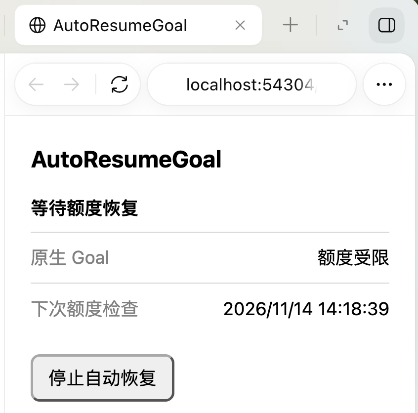
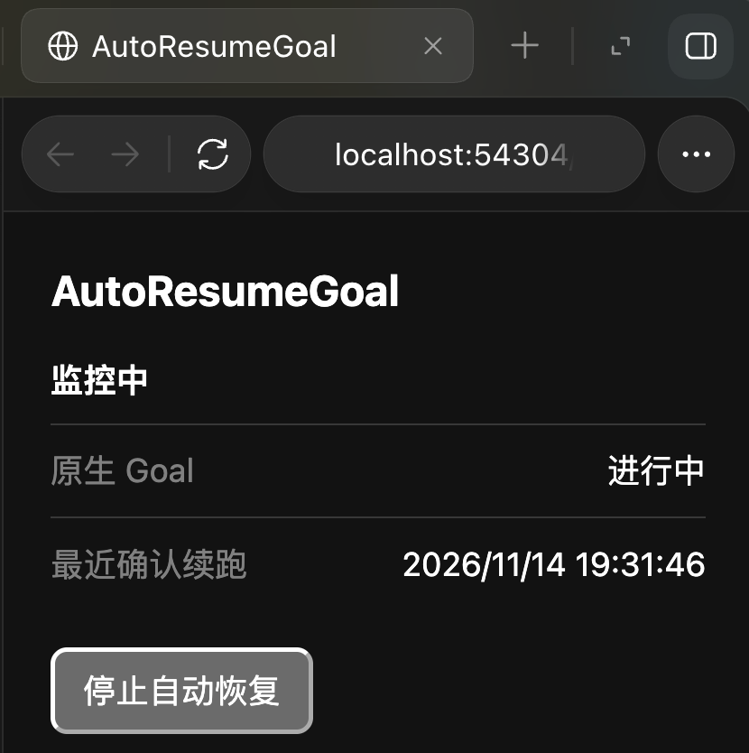

# AutoResumeGoal

[English](README.md) · [简体中文](README.zh-CN.md) · [繁體中文](README.zh-TW.md) · [日本語](README.ja.md) · [한국어](README.ko.md) · [Tiếng Việt](README.vi.md)

**额度恢复后，在原聊天中自动续跑原生 Codex Goal。**


> Linux 预览版。监控服务在使用 systemd 的 Linux 上运行。

## 实际运行

面板显示原生 Goal 的状态、下次额度检查时间，以及原聊天最近一次确认启动新轮次的时间。

| 监控中 | 等待额度恢复 | 已确认续跑 |
| :---: | :---: | :---: |
|  |  |  |

## 快速开始

在运行 Goal 的 Linux 主机上执行以下命令。私有仓库需要有访问权限的 GitHub 账号。安装前请检查是否已有同名技能。若技能选择器中未出现 `$auto-resume-goal`，请重启 Codex。

```bash
git clone https://github.com/realpan/auto-resume-skill.git
cd auto-resume-skill
mkdir -p "$HOME/.agents/skills"
cp -R skills/auto-resume-goal "$HOME/.agents/skills/"
python3 -m pip install -r requirements.txt
```

需要 Python 3.9+、运行中的 systemd 用户管理器，以及已登录且启用 Goal 的 Codex。监控必须连接拥有原聊天的 App Server。如使用虚拟环境，请用该环境的 Python 安装依赖并运行脚本。

```text
$auto-resume-goal 迁移日期解析器。新解析器能处理所有测试数据且测试套件通过后结束。
```

| 操作 | 输入 |
| --- | --- |
| 监控当前 Goal | `$auto-resume-goal monitor this goal` |
| 查看状态 | `$auto-resume-goal status` |
| 停止监控 | `$auto-resume-goal stop` |

### 使用远程 Linux 主机的 macOS 或 Windows

在桌面端连接使用 systemd 的 Linux 主机，打开远程项目，在远程聊天中启动 Goal。以运行 Codex 的用户身份在 Linux 主机上安装技能，再在原聊天中开启监控并检查状态。侧边面板需要桌面客户端能访问远程主机的回环服务。也可用状态命令和服务日志。

## 工作原理

服务绑定聊天 ID、Goal 创建时间和目标指纹，每个聊天只运行一个监控。进入 `usageLimited` 后，按耗尽窗口的重置时间安排复查。普通额度明确可用、原聊天空闲且 Goal 仍匹配时，恢复原 Goal，保留原目标和预算。确认原聊天启动新轮次后继续监控。结果无法确认时退出，请检查原聊天。

Goal 完成、暂停、阻塞、用完自身预算、被移除或修改时，监控退出。手动停止监控保留 Goal 的原生状态，已提交的恢复请求仍可能生效。主机重启后需重新开启监控。

支持打开面板的 Codex 桌面端会在聊天右侧显示实时状态。面板按指定语言、聊天语言和浏览器偏好选择受支持的语言，默认回退到英语。支持简体中文、繁体中文、英语、日语、韩语和越南语。

## 故障排查

连接失败时，确认运行中的 daemon 拥有该聊天，并检查套接字路径。超过重置时间仍在等待时，检查服务日志、实时普通额度和聊天是否空闲。续跑结果不明时，先检查原聊天再重新开启监控。

默认套接字为下方路径，可用 `--socket` 指定其他本地套接字。App Server 需返回 `ordinaryUsageAllowed` 并支持通过 `thread/goal/set` 自动恢复。开发环境使用 CLI 0.167.1 和 App Server 0.169.0。

```bash
printf '%s\n' "${CODEX_HOME:-$HOME/.codex}/app-server-control/app-server-control.sock"
codex app-server daemon version
python3 skills/auto-resume-goal/scripts/auto_resume_goal.py status --thread CHAT_UUID
python3 skills/auto-resume-goal/scripts/auto_resume_goal.py start --thread CHAT_UUID
python3 skills/auto-resume-goal/scripts/auto_resume_goal.py stop --thread CHAT_UUID
journalctl --user -u codex-auto-resume-goal-CHAT_UUID.service
```

## 验证

```bash
python3 -m unittest discover -s tests -v
```

测试覆盖额度与重置时间、Goal 身份、读取重试、续跑结果不明和监控退出。2026 年 11 月 14 日，开发环境在同一聊天中记录了两次等待额度后确认续跑的过程。截图来自这次运行。验证其他环境时，请核实额度不可用时保持等待、自然恢复后原聊天启动新轮次，以及完成或手动停止后监控退出。手动停止时检查 Goal 状态是否保持。

## 相关项目

[Codex Auto Resume](https://github.com/progressrdx/codex-auto-resume) · [unsnooze](https://github.com/saaranshM/unsnooze) · [Goal Ledger](https://github.com/kingbootoshi/goal-ledger)

[SKILL.md](skills/auto-resume-goal/SKILL.md) · [Codex Goals](https://learn.chatgpt.com/docs/long-running-work) · [App Server](https://learn.chatgpt.com/docs/app-server)

## 许可证

[MIT](LICENSE)
